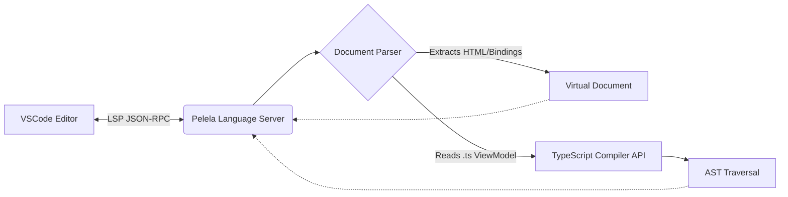

# VSCode Extension Architecture

The PelelaJS extension provides Language Server Protocol (LSP) features to enhance developer productivity when working with `.pelela` templates.

## Core Features

The extension is designed to bridge the gap between the declarative `.pelela` template and the underlying `.ts` ViewModel, providing:

- **Syntax Highlighting:** Custom grammar rules for Pelela-specific syntax (e.g., `bind-content`, `bind-value`, `click`).

- **Autocomplete & Intellisense:** Intelligent suggestions for model properties and methods inside the template.

- **Go to Definition:** Navigating from a bound property in the template directly to its declaration in the TypeScript file.

## CLI Commands

The extension exposes the project CLI operations in the editor, so students do not have to switch to a terminal:

| Command | Available from | CLI invocation |
| --- | --- | --- |
| `Pelela: Rename component` | Explorer context menu, command palette | `pelela rename <component> <newName>` |
| `Pelela: Move component` | Explorer context menu, command palette | `pelela move <component> <destination>` |
| `Pelela: New component` | Explorer context menu on a folder | `pelela new <folder/name>` |
| `Pelela: Add testing` | Command palette | `pelela add testing` |

Rename and move require a sibling `.pelela` template: a `.ts` file without one is reported as not a component before the CLI runs. The extension only validates that the input is not empty; name validation stays in the CLI, which is the single source of truth.

The commands spawn `node <entrypoint>` without a shell. The entrypoint is read from the `bin` field of the `pelelajs` package installed in the project (or the monorepo root), so the same code path works on Windows and POSIX. All arguments reach the CLI with forward slashes, and the process receives `NO_COLOR=1`, `FORCE_COLOR=0` and `PELELA_SKIP_UPDATE_CHECK=1`.

### Settings

- `pelela.cli.path`: entrypoint override. Empty by default (use the installed package).
- `pelela.cli.nodePath`: Node.js executable used to run the CLI. Defaults to `node`.

## Architectural Overview

The extension operates as a standard VSCode Language Client/Server model.

### The Parsing Mechanism

To provide intelligent feedback, the Language Server must understand both the HTML-like structure of the View and the TypeScript AST (Abstract Syntax Tree) of the ViewModel.

1. **Document Synchronization:** As the user types in a `.pelela` file, the server receives text document synchronization events.

2. **Context Resolution:** When a user requests autocomplete or definition (e.g., hovering over `user.name` inside `bind-content="user.name"`), the server identifies the exact position in the document.

3. **TypeScript Integration:** The server uses the TypeScript Compiler API to analyze the companion `.ts` file. It traverses the AST to find public properties, methods, and types defined within the ViewModel class.

4. **Mapping:** It maps the token found in the template (e.g., `user.name`) to the corresponding AST node in the ViewModel, returning the required LSP response (like a `Location` or a list of `CompletionItem`s).

## Developing the Extension

When adding new features:

- Leverage existing parsing utilities rather than writing custom Regex for complex TypeScript structures.

- Ensure the extension fails gracefully. If a `.ts` file has syntax errors, the language server should degrade without crashing.
